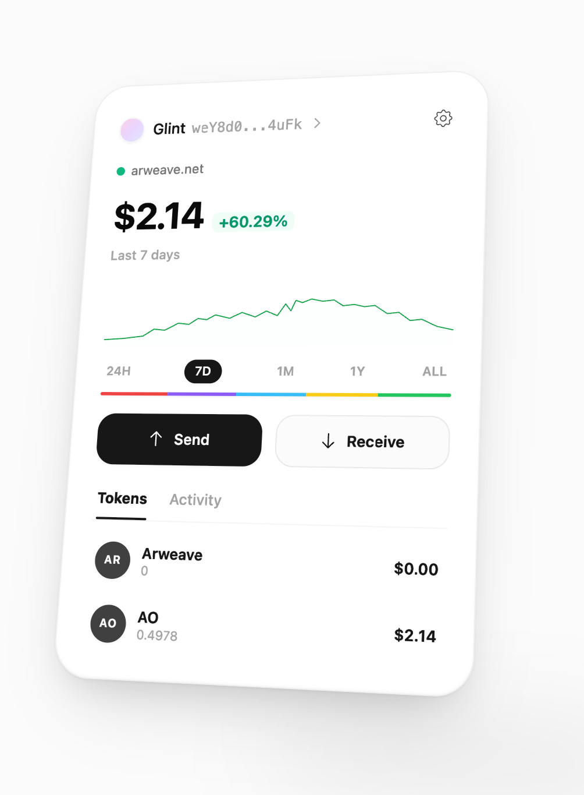

# Gleam



A Chrome browser-extension wallet for Arweave and AO.

## For dApp developers

### Works with `window.arweaveWallet`

Gleam implements the ArConnect API.

Code written for
`window.arweaveWallet` **works with Gleam unchanged.**

### Add a Connect with Gleam button

use `window.gleam` instead of `window.arweaveWallet`

If `window.gleam` is `undefined` the wallet isn't installed and you can link to the
[Chrome Web Store](https://chromewebstore.google.com/detail/gleam/einabcphdmlicabnjllaaallnebfkmki)
instead.

<details>
<summary>Example</summary>

```js
const button = document.querySelector("#connect-gleam");

function showButton() {
  if (window.gleam) button.hidden = false;
}
showButton();
window.addEventListener("gleamWalletLoaded", showButton);

button.addEventListener("click", async () => {
  await window.gleam.connect(["ACCESS_ADDRESS", "SIGN_TRANSACTION"], {
    name: "My dApp",
    logo: "https://example.com/logo.png",
  });
  const address = await window.gleam.getActiveAddress();
});
```

</details>

## Development

<details>
<summary>Build and test</summary>

```bash
pnpm install
pnpm dev            # dev build with live reload
pnpm wxt:build      # production build
pnpm vitest run     # tests
```

Load `apps/extension/.output/chrome-mv3` unpacked in Chrome to try it.

</details>

## License

[MIT](LICENSE)
