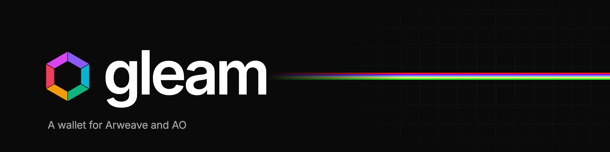
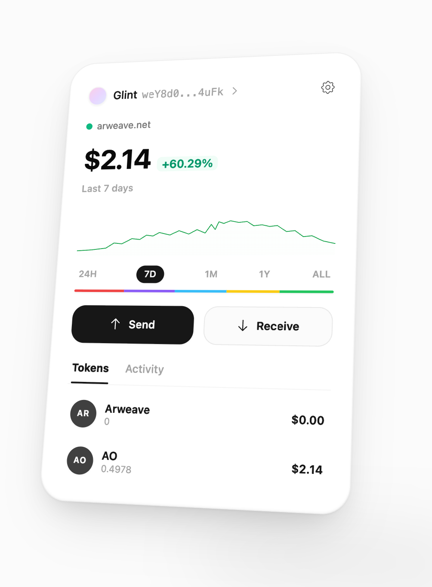

[](https://www.bestpractices.dev/projects/17147)



A Chrome browser-extension wallet for Arweave and AO.

## For dApp developers

### Works with `window.arweaveWallet`

Gleam implements the [ArConnect API](https://docs.arconnect.io/api/intro).
Code written for `window.arweaveWallet` works unchanged, except:

- `privateHash` is not supported. It needs the private key to stay
  readable while the wallet is unlocked.
- `signature` is deprecated and not supported. It signs whatever bytes a
  site passes. Use `signMessage` or `signDataItem`.

### Keep a user's data private across devices

Use `encrypt` and `decrypt` to lock your app's data key to the user's
wallet, so they can open their data on any device.

<details>
<summary>Example</summary>

```js
await window.arweaveWallet.connect(["ENCRYPT", "DECRYPT"]);

const key = crypto.getRandomValues(new Uint8Array(32)); // your app's data key
const locked = await window.arweaveWallet.encrypt(key, { name: "RSA-OAEP" });
// Later, on any device:
const sameKey = await window.arweaveWallet.decrypt(locked, {
  name: "RSA-OAEP",
});
```

</details>

### Add a Connect with Gleam button

Use `window.gleam` to open Gleam's connect approval window. It supports the
same methods as `window.arweaveWallet`.

If `window.gleam` is `undefined`, Gleam is not installed:

- On a computer, link to
  [gleamwallet.app/download](https://gleamwallet.app/download).
- On a phone, label the button "Open in Gleam" and link to
  `https://open.gleamwallet.app/browse?url=<your page, URL-encoded>`. It
  opens your dApp in the Gleam app, or the download page if the app is
  not installed.

Put the [Gleam icon](apps/site/favicon.svg) next to the text, in `Inter`
at medium weight:

```text
[icon] Connect with Gleam
[icon] Open in Gleam
```

<details>
<summary>Example</summary>

```js
// <a id="connect-gleam" hidden><span class="label">Connect with Gleam</span></a>
const button = document.querySelector("#connect-gleam");

function showButton() {
  if (window.gleam) button.hidden = false;
}
showButton();
window.addEventListener("gleamWalletLoaded", showButton);

if (!window.gleam && /Android|iPhone|iPad/i.test(navigator.userAgent)) {
  button.href = `https://open.gleamwallet.app/browse?url=${encodeURIComponent(location.href)}`;
  button.querySelector(".label").textContent = "Open in Gleam";
  button.hidden = false;
}

button.addEventListener("click", async (event) => {
  if (!window.gleam) return;
  event.preventDefault();
  await window.gleam.connect(["ACCESS_ADDRESS", "SIGN_TRANSACTION"], {
    name: "My dApp",
    logo: "https://example.com/logo.png",
  });
  const address = await window.gleam.getActiveAddress();
});
```

</details>

## Development

### Repository layout

The wallet is split into shared packages that both apps are built from.
Each folder has a README with more detail.

```text
Extension        Mobile
    └──────┬───────┘
           ▼
         /app       screens and UI
           │ messages
           ▼
       /runtime     request handler
           │
           ▼
         /core      keys, signing, AO
```

- [`packages/core`](packages/core): the domain logic: keys, signing, Arweave
  and AO, and the rules behind each feature.
- [`packages/runtime`](packages/runtime): the background that checks and
  handles every request.
- [`packages/app`](packages/app): every screen the user sees.
- [`packages/ui`](packages/ui): the design system the screens are built
  from.
- [`packages/messaging`](packages/messaging): the messages the wallet's
  parts send each other.
- [`packages/provider`](packages/provider): the `window.arweaveWallet`
  script that runs in dApp pages.
- [`packages/keystone`](packages/keystone): Keystone hardware wallet
  support over QR codes.
- [`apps/extension`](apps/extension): the Chrome extension.
- [`apps/mobile`](apps/mobile): the iOS and Android app.
- [`apps/points-api`](apps/points-api): the Gleam Points server.
- [`apps/site`](apps/site): the gleamwallet.app website.
- [`apps/site-open`](apps/site-open): the site that opens links in the
  mobile app.
- [`scripts/scan`](scripts/scan): the `pnpm scan` CLI for community
  security scans.

<details>
<summary>Build and test</summary>

```bash
pnpm install
pnpm dev            # dev build with live reload
pnpm wxt:build      # production build
pnpm test           # tests
```

Load `apps/extension/.output/chrome-mv3` unpacked in Chrome to try it.

</details>

<details>
<summary>Verify a release</summary>

The script builds the tag from source and checks that your zip has the
same hash as the
[release](https://github.com/skyf0xx/gleam-arweave-ao-hyperbeam-wallet/releases).

```bash
scripts/verify-release.sh v1.27.0
```

</details>

<details>
<summary>Build by hand</summary>

Use Node 22 and pnpm 11.25.0.

```bash
git clone --branch v1.27.0 https://github.com/skyf0xx/gleam-arweave-ao-hyperbeam-wallet.git
cd gleam-arweave-ao-hyperbeam-wallet
pnpm install --frozen-lockfile
pnpm --filter @gleam/extension exec wxt zip
```

The zip is in `apps/extension/.output/`.

</details>

<details>
<summary>Check the zip by hand</summary>

```bash
gh attestation verify gleamextension-1.27.0-chrome.zip --repo skyf0xx/gleam-arweave-ao-hyperbeam-wallet
sha256sum gleamextension-1.27.0-chrome.zip   # must match zipSha256 in release-manifest.json
```

</details>

<details>
<summary>Check the copy installed in Chrome</summary>

```bash
scripts/verify-release.sh v1.27.0 --installed "$HOME/Library/Application Support/Google/Chrome/Default/Extensions/einabcphdmlicabnjllaaallnebfkmki/1.27.0_0"
```

Chrome's extension folder:

- macOS: `~/Library/Application Support/Google/Chrome/Default/Extensions/`
- Windows: `%LOCALAPPDATA%\Google\Chrome\User Data\Default\Extensions\`
- Linux: `~/.config/google-chrome/Default/Extensions/`

The Web Store adds `_metadata/`, `key` and `update_url`, and the script
ignores them.

</details>

## License

[MIT](LICENSE)
